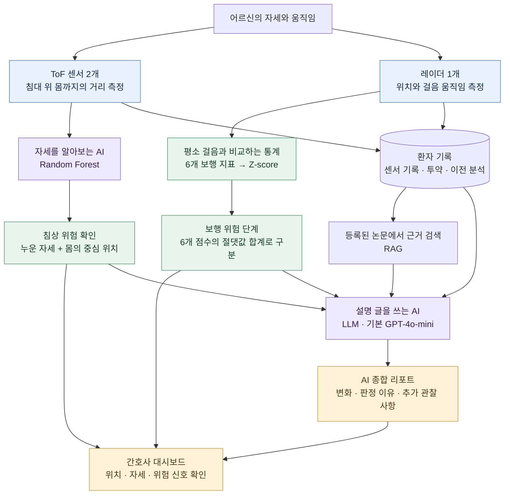
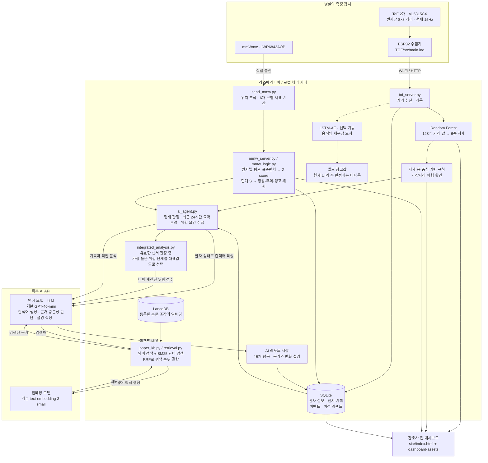

# 마주봄 시스템 구성도

어르신의 움직임을 숫자로 살피고, 평소와 달라진 점을 찾아 간호사에게 보여주는 구조입니다.
현재 소스 기준으로 자세를 분류하는 AI, 보행 점수를 계산하는 통계, 리포트를 쓰는 AI를 구분했습니다.

## 실제 배치와 두 화면(2026-10-06)

[HTML 시스템 구성도](docs/SYSTEM_ARCHITECTURE.html)에서 노드별 코드·API와 두 데이터 경로를 볼 수 있습니다.

- ToF 둘 다 높이 1.2m, 수평에서 하향 tof1(발) 50°·tof2(머리) 30°(2026-10-08 변경; 20°는 매트리스가 시야 아래 몇 줄에만 닿아 폐기). 센서마다 ESP32-S3 하나, 2.4GHz Wi-Fi → 유선 Pi.
- mmWave 높이 2.5m, 하향50°. USB DATA는 send_mmw.py 한 프로세스가 읽습니다.
- 기존 간호사 경로는 센서 수신 → SQLite·판정 → :5001/dashboard로 계속 동작합니다.
- 같은 수신값의 추가 사본은 server/live_diagnostics.py → :5012/api/ingest → 로우데이터 화면으로 갑니다.
  이 추가 분기만 최신 프레임을 메모리에 유지하고 DB·파일·브라우저 히스토리에 저장하지 않습니다.
  기존 운영 데이터 저장을 대체하지 않습니다.
- 실제 센서 스트림과 로우데이터 관측은 연결 환자 bed_01 전용입니다. 가상 환자 EMR과 기존 시뮬레이션은 별도 경로입니다.
- 로우데이터 화면의 ToF/mmWave 탭은 수식·실제 입력·평균·Z-score·DB 행/라벨을 읽기 전용으로 관측합니다.
  융합·이벤트 탭은 실제 판정/저장 사건을, AI 탭은 실제 생성 질문·검색·작성·저장 단계를 보여줍니다.
  diagnostic_observer.py와 report_trace.py는 제한된 RAM 기록만 추가하며 조회로 기존 처리를 재실행하지 않습니다.
- 실행과 좌표/장치 검증 한계는 [진단 안내](docs/SENSOR_DIAGNOSTICS.md)를 읽습니다.

## 개인 EMR 저장과 검색

`/emr` 화면은 실제 SQLite 원문과 SQL 열, 환자별 LanceDB 연결을 보여줍니다.
원문 emr_records.id/bed_id → emr_chunks.record_id/patient_id → 해당 환자만 검색 → AI 리포트 입력.
가상 환자 5명의 EMR 15건은 별도로 표시하며 실제 연결 환자에게 넣지 않습니다.
현재 개인 EMR은 512차원 로컬 어휘 벡터이며 API 의미 임베딩은 emr_semantic_chunks로 분리합니다.
논문 paper_chunks와 과거 보고서 analysis_chunks는 각각 기존 컬렉션을 유지합니다.
자세한 정책과 실행은 [EMR 데이터 모델](docs/EMR_DATA_MODEL.md)을 읽습니다.

## 한눈에 보는 구성



센서 값 수신·저장과 자세·보행 분석은 라즈베리파이 및 로컬 서버에서 처리하는 구성입니다.
실제 리포트를 작성할 때는 외부 모델 API를 사용합니다.

## 장치와 프로그램의 연결



연결선은 주요 데이터의 흐름입니다. 간호사 화면의 센서 표시와 AI 리포트 생성은 별도 경로입니다.
실제 구성에서 서버를 어느 컴퓨터에 실행하는지, 모델 이름을 무엇으로 설정하는지는 배포 설정에 따라 달라질 수 있습니다.

## 무엇을 AI가 하고, 무엇을 계산식이 하나요?

| 역할 | 사용 방식 | 쉬운 설명 |
|---|---|---|
| 침대 위 자세 분류 | Random Forest, 판단 나무 200개 | 거리 모양을 보고 누웠는지, 앉았는지 등을 고릅니다. |
| 침상 가장자리 위험 | 분류된 자세 + 몸 중심 위치에 대한 규칙 | 누운 몸이 가장자리로 치우쳤는지 정해진 조건으로 확인합니다. |
| 평소와 다른 보행 | Z-score 기반 통계 | 그 환자의 평소 걸음과 얼마나 다른지 계산합니다. |
| 보행 위험 단계 | 6개 지표의 절댓값 합계와 기준값 | 계산된 변화 점수를 정상·주의·경고·위험으로 나눕니다. |
| 움직임 이상 참고값 | LSTM-AE | 움직임을 다시 재현했을 때 원래 기록과 얼마나 다른지 살핍니다. |
| 리포트 근거 검색 | 의미 검색 + BM25 + RRF | 비슷한 뜻과 핵심 단어로 관련 논문을 찾고 검색 순위를 합칩니다. |
| AI 종합 리포트 | RAG 구성 + LLM | 환자 기록과 검색된 자료를 함께 읽어 이해하기 쉬운 설명을 작성합니다. |

### Z-score와 LSTM-AE의 관계

**현재 보행 Z-score는 LSTM-AE로 구하지 않습니다.**

```text
Z-score = (현재 측정값 − 그 환자의 평소 평균) ÷ 표준편차
S = 6개 보행 지표의 |Z-score| 합계

정상: S < 3
주의: 3 ≤ S < 6
경고: 6 ≤ S < 9
위험: S ≥ 9
```

표준편차는 평소 측정값이 흔들리는 폭입니다. 실제 코드에서는 지표별 최소 표준편차도 적용합니다.
기준 기록이 14일 미만이거나 표본이 부족한 경우 정식 보행 알림을 보류하며, 측정 품질과 환자 식별 등도 확인합니다.
높이 변화에 대한 긴급 규칙은 별도로 있습니다. 이 점수는 낙상 확률이 아닙니다.

LSTM-AE는 ToF 움직임 특징을 입력받아 재구성 오차를 계산하는 별도 참고 모델입니다.
`/tof/anomaly`의 주 판정은 자세·몸 중심 규칙이고, LSTM-AE 결과는 응답의 `lstm` 항목에 별도로 들어갑니다.

### AI 리포트가 하는 일

현재 센서 판정, 환자 정보·투약·위험 요인, 최근 24시간 활동 요약과 이벤트, 직전 분석, 검색된 논문을 이용합니다.
위험 점수는 먼저 규칙으로 계산하고, LLM은 그 이유와 변화·추가 관찰 사항을 설명합니다.
RAG는 검색한 자료를 LLM에 함께 제공하는 구성 방식이며, 논문으로 모델을 다시 학습시키는 작업과 다릅니다.

### 입원 기록 기반 보행 기대 범위

센서 기록이 쌓이기 전에는 나이·키·진단·과거 병원 기록과 논문 수치로 보행속도의 기대 범위를 만듭니다.
출처는 한국 노인 기준값, 치매·파킨슨 감소량, 요양시설 평균, 실험실↔일상 차이 논문입니다.
AI는 치매 중증도·파킨슨증·보행 상태를 판단하고 두 문헌 경로 사이 비중을 제안합니다. 인용이 실제 기록 문장에 있고,
인용한 부분 안의 단서가 판단을 뒷받침할 때만 채택합니다. 과거 측정 보행속도와 예측 밖 낙상 요인은 서버 규칙으로만 뽑습니다.
개인 기록이 5건 미만인 동안은 '잠정' 판정(주의·경고까지, 정식 알람 없음)만 하고, 이후에는 개인 기준이 우선합니다.
잠정 판정은 통합 위험 점수에 넣지 않고 대시보드에 "잠정"으로 따로 표시합니다.
걸려 넘어짐·갑자기 힘이 빠지는 주저앉음처럼 센서가 미리 알 수 없는 낙상 요인은 "센서 예측 범위 밖"으로 따로 표시합니다.
자세한 공식·출처·한계는 [server/gait_prior.md](server/gait_prior.md)에 있습니다.

### 실험 코드와의 구분

`TOF/ml/retrain_with_tabpfn.py`의 TabPFN 보조 재학습, `research/alternatives/`의 후보 알고리즘 비교,
`server/maintenance_ai.py`의 변화 감시는 실험·검토용 경로입니다. 현재 주 위험 판정의 직렬 처리 단계로 그리지 않았습니다.
시뮬레이션의 정해진 상태 변화와 실제 센서 판정도 구분합니다.

구성도는 현재 구현의 데이터 흐름을 설명합니다. 실제 낙상을 반드시 예측하거나 예방한다는 성능 보장을 뜻하지 않습니다.

## 구현 위치

- [ToF 수신·자세·침상 위험](server/tof_server.py)
- [자세 모델 학습](TOF/ml/train_posture.py)
- [LSTM-AE 참고값](server/tof_anomaly.py)
- [레이더 지표 계산](mmWave/send_mmw.py)
- [보행 Z-score와 단계 판정](server/mmw_logic.py)
- [입원 기록 기반 보행 기대 범위](server/gait_prior.py), [근거 수치](server/gait_evidence.json)
- [환자 상태 수집과 검색 흐름](server/ai_agent.py)
- [논문 검색](server/paper_kb.py), [검색 순위 결합](server/retrieval.py)
- [통합 위험 점수와 리포트](server/integrated_analysis.py)
- [대시보드 API](server/dashboard_api.py)
